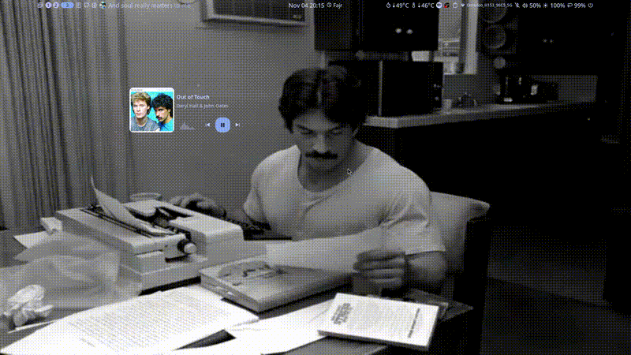
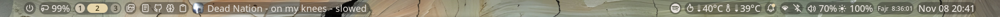
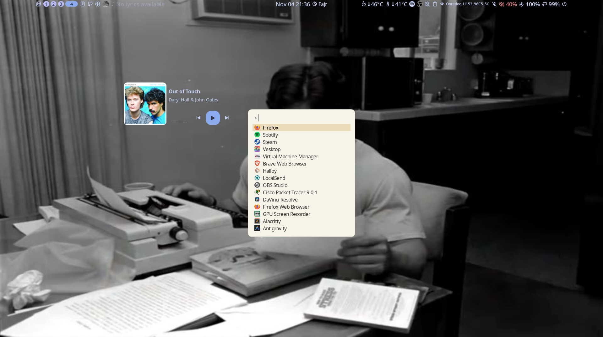
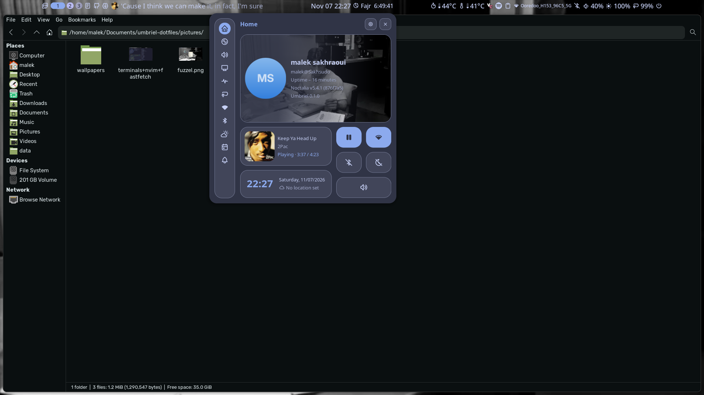
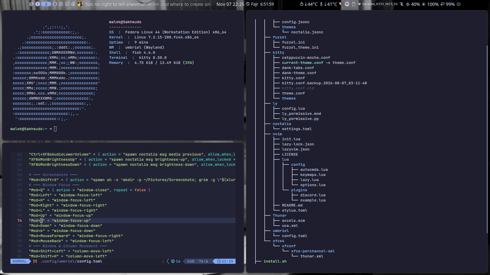

# umbriel-dotfiles ( for ONLY fedora 44, for now)

My personal dotfiles for Fedora 44 running Umbriel and Noctalia.
always evolving as my workflow changes.

## Showcase  



*Note: The GIF below is to demonstrate the movement and animations. See the screenshots below for the most up-to-date look of the bar and desktop.*

*[Click here to watch the full video with sound on YouTube](https://youtu.be/GQyFk1kP-DE)*

## Screenshots
v1.5.0 updated on Nov 8: 
<p align="center">
  
</p>

bar:
<p align="center">
  
</p>


app launcher:
<p align="center">
  
</p>

ctrl center with thunar
<p align="center">
  
</p>

<p align="center">
  
</p>


## Description
I personally use Ly as a display manager but that comes with SELinux tweaking which is smth big, so i removed it from the installation and kept GDM the default DM used by most ppl.
This repository contains my configuration files for the following applications:

| Component | Details |
| :--- | :--- |
| OS | Fedora 44 |
| Compositor | Umbriel (Wayland) |
| Shell/Bar | Noctalia v5 |
| Display Manager | GDM |
| Terminal | Kitty |
| Text Editor | Neovim (LazyVim) |
| File Manager | Thunar |
| App Launcher | Fuzzel |
| Fetch | Fastfetch |

IMPORTANT: For a full list of keyboard/mouse shortcuts, see [KEYBINDS.md](KEYBINDS.md).

## Noctalia Plugins

*   goatnath/spotify-lyrics
*   h465855hgg/lyrics
*   noctalia/notes
*   shangshui0302/github-kanban
*   ycf/mawaqit
*   thepunkoff/pomodoro

## Installation

1. Clone the repository:
```console
  -- git clone https://github.com/msakhraoui/umbriel-dotfiles.git
```

2. Change into the directory:
```console
   cd umbriel-dotfiles
```

3. Run the install script:
```console
   ./install.sh
```


## What's Inside

```text
config/          -> Application configurations (Umbriel, Noctalia, Kitty, etc.)
pictures/        -> Wallpapers and showcase GIF
install.sh       -> Automated installation script
```

## Notes

This configuration is provided as is. It is designed for my specific hardware and workflow. You may need to adjust keybinds, monitor names, and paths to match your own setup. have fun1!
