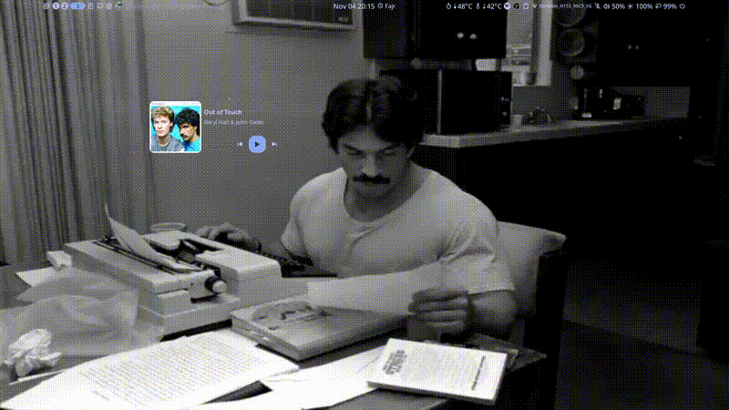

# umbriel-dotfiles ( for ONLY fedora 44, for now)

My personal dotfiles for Fedora 44 running Umbriel and Noctalia.

## Showcase



*[Click here to watch the full video with sound on YouTube](https://youtu.be/GQyFk1kP-DE)*
## Description

This repository contains my configuration files for the following applications:

- Umbriel (Wayland compositor)
- Noctalia (Desktop shell)
- Ly (Display manager)
- nvim [neovim/lazyvim](Text editor)
- Kitty (Terminal emulator)
- Fastfetch (System information)
- Fuzzel (app launcher)
- Thunar (File manager)

## WARNING about SELinux (Fedora) ( i already automated this in the install.sh remove the automated parts if you wanna config it manually since you cant blindly trust me ofc)
Ly may fail to launch a session on Fedora due to SELinux. If this happens(which probably will ), generate a local policy module:

    sudo ausearch -m avc -ts recent | audit2allow -M ly_permissive
    sudo semodule -i ly_permissive.pp

This is a known issue and the fix is recommended by the Ly developers.

## Installation

1. Clone the repository:
```console
  -- git clone https://github.com/msakhraoui/umbriel-dotfiles.git
```

2. Change into the directory:
```console
   cd umbriel-dotfiles
```

3. Run the install script:
```console
   ./install.sh
```

## Contents

- config/umbriel - Umbriel configuration
- config/noctalia - Noctalia configuration
- config/kitty - Kitty configuration
- config/fastfetch - Fastfetch configuration
- config/nvim - nvim configuration
- config/ly - Ly configuration
- config/Thunar - Thunar config
- config/Fuzzel - Fuzzel config
- pictures/wallpapers - Wallpapers

## Notes

This configuration is provided as is. It is designed for my specific hardware and workflow. You may need to adjust keybinds, monitor names, and paths to match your own setup.

## License

Do whatever you want with it.
